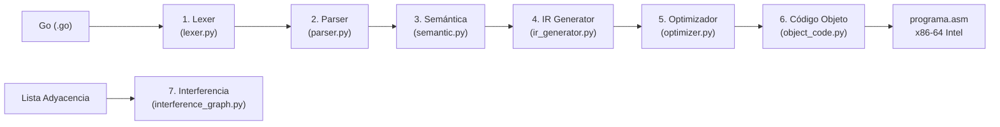

# Guía para Agentes y Desarrolladores (AGENTS.md)

Referencia técnica compacta para agentes de IA y desarrolladores. Diseñada para comprender la arquitectura, ejecutar comandos esenciales y extender el compilador de manera rápida y segura.

---

## 1. Visión General del Proyecto

- **Naturaleza**: Compilador interactivo y asignador de registros web para un subconjunto representativo de **Go (Golang)**.
- **Contexto**: Lenguajes y Autómatas II (LYA2).
- **Entorno**: Python 3.14 (`requires-python = ">=3.14"`), gestionado con `uv` / `.venv`.
- **Rama principal activa**: `main`.
- **Stack Técnico**:
  - **Léxico y Sintáctico**: [SLY (Sly Lex Yacc) 0.5](https://github.com/dabeaz/sly) (LR Parser).
  - **Backend REST**: [FastAPI 0.133+](https://fastapi.tiangolo.com/) y validación con [Pydantic v2](https://docs.pydantic.dev/).
  - **Visualización**: [Vis.js Network](https://visjs.org/) (grafos de fuerza interactivos) y [Mermaid.js](https://mermaid.js.org/) (AST y CFG).

---

## 2. Comandos Operativos Indispensables

Todos los comandos deben ejecutarse desde la raíz del proyecto usando el entorno `.venv`.

```bash
# 1. Iniciar servidor FastAPI con recarga en caliente (puerto 8000):
.venv/bin/python app/main.py
# o: .venv/bin/python -m uvicorn app.main:app --host 127.0.0.1 --port 8000 --reload

# 2. Ejecutar la suite completa de pruebas unitarias (79 pruebas requeridas):
.venv/bin/python -m unittest discover tests -v

# 3. Ejecutar suites específicas:
.venv/bin/python -m unittest tests/test_lexer_parser.py         # Léxico y sintáctico (30 tests)
.venv/bin/python -m unittest tests/test_semantic.py             # Semántico y scopes (12 tests)
.venv/bin/python -m unittest tests/test_ir.py                   # TAC, triplos, cuádruplos (7 tests)
.venv/bin/python -m unittest tests/test_optimizer.py            # CFG y optimizaciones U3 (11 tests)
.venv/bin/python -m unittest tests/test_interference_graph.py  # Grafos de interferencia (8 tests)
.venv/bin/python -m unittest tests/test_object_code.py         # Generación código objeto U4 (14 tests)

# 4. Validar evidencia y ejecución nativa en Linux x86-64:
.venv/bin/python ejemplos/u4/verificar.py
```

---

## 3. Arquitectura del Pipeline y Datos

El compilador procesa el código a través de 7 etapas acopladas mediante modelos Pydantic:



| Fase | Archivo Core | Entrada | Salida Principal (Pydantic / UI) |
| :--- | :--- | :--- | :--- |
| **1. Léxico** | `app/core/lexer.py` | Código fuente Go | `LexerResponse` (tokens categorizados y errores) |
| **2. Sintáctico** | `app/core/parser.py` | Tokens | `ParseResponse` (AST tuplas, JSON y diagrama Mermaid) |
| **3. Semántico** | `app/core/semantic.py` | AST | `SemanticResponse` (tabla de símbolos y chequeo de tipos) |
| **4. Código Intermedio** | `app/core/ir_generator.py` | AST válido | `IRResponse` (TAC, tripletas, cuádruplos y postfijo) |
| **5. Optimización (CFG)** | `app/core/optimizer.py` | Cuádruplos IR | `OptimizationResponse` (CFG Mermaid, métricas, transforms) |
| **6. Código Objeto (U4)** | `app/core/object_code.py` | Cuádruplos / AST | `ObjectCodeResponse` (ASM x86-64 Intel, registros.csv, tabla de derrames) |
| **7. Asignación Registros**| `app/core/interference_graph.py`| Lista Adyacencia | `InterferenceGraphResponse` (coloreo óptimo $\chi$, Vis.js) |

### Estructura de Directorios

```text
.
├── app/
│   ├── api/routes.py              # Endpoints REST (/tokenize, /parse, /semantic, /ir, /optimize, /interference-graph, /object-code)
│   ├── api/schemas.py             # Modelos de validación Pydantic v2
│   ├── core/                      # Módulos del compilador (lexer, parser, semantic, ir, optimizer, interference, object_code, native_ir, register_allocator)
│   ├── templates/index.html       # SPA interactiva (Compilador Go + Código Objeto + Visualizador Vis.js)
│   └── main.py                    # Punto de entrada FastAPI
├── tests/                         # Suite de 79 pruebas unitarias
├── ejemplos/                      # Casos .go, .ir y entregables de Unidad 3 y Unidad 4
│   ├── u3/                        # Entregables de Optimización U3
│   └── u4/                        # Entregables de Código Objeto U4 (integrador.go, programa.asm, registros.csv, etc.)
├── README.md                      # Documentación para usuarios
├── AGENTS.md                      # Esta guía técnica para agentes
└── pyproject.toml / uv.lock       # Dependencias del proyecto
```

---

## 4. Convenciones Internas y Estructuras de Datos

### 4.1. AST (`parser.py`)
Representado como tuplas etiquetadas:
- Programa: `('program', [items...])`
- Declaraciones: `('var_decl', name, type, init, line)`, `('short_var_decl', name, expr, line)`
- Funciones: `('func_decl', name, [(param, type)...], return_type, [body...])`
- Control: `('if', cond, then_blk, else_blk, line)`, `('for_three', init, cond, post, body, line)`
- Expresiones: `('binary_op', op, left, right, line)`, `('literal', type, value, line)`

### 4.2. Jerarquía de Scopes (`semantic.py`)
- Cadenas con puntero a `parent`: `"global"` $\rightarrow$ `"local:<func_name>"` $\rightarrow$ `"local:<func_name>:if"`.
- Métodos: `scope.define(name, type, line)`, `scope.lookup(name)` (recursivo), `scope.lookup_current(name)`.

### 4.3. Cuádruplos y TAC
- `ir_generator.py`: `Quadruple(index, op, arg1, arg2, result)` con triplos format `#(idx) (op, a1, a2, res)`.
- `optimizer.py`: `Quad(op, arg1, arg2, result, block_id)` con `.to_tac()` y `.clone()`.
- Operadores TAC: aritméticos (`+`, `*`, etc.), saltos (`label`, `goto`, `ifFalse`, `ifTrue`) y llamadas (`param`, `call`, `return`).

### 4.4. Grafos de Interferencia y Registros (`interference_graph.py`)
- **Parser**: Soporta `A: B, C`, `A: B C`, `A-B`, comentarios `#` y nodos aislados. Garantiza no-direccionalidad simétrica.
- **Coloración Mínima**: Heurística DSATUR inicial + Branch & Bound exhaustivo para garantizar el número cromático exacto $\chi(G)$.
- **Mapeo**: Cada color se asigna a un registro CPU ($R_1, R_2, \dots$) y paleta visual de alto contraste.

### 4.5. Generación de Código Objeto (`object_code.py`, `register_allocator.py`, `native_ir.py`)
- **Arquitectura**: x86-64 Linux con GNU Assembler (GAS) en sintaxis Intel (`.intel_syntax noprefix`).
- **Registros**: Asigna registros callee-saved (`rbx`, `r12`, `r13`, `r14`, `r15`) a variables y temporales mediante análisis de vida y coloración voraz.
- **Derrames (Spills)**: Variables excedentes se almacenan en `[rbp - offset]`.
- **Llamadas y ABI**: System V AMD64 ABI con marco alineado a 16 bytes. Parámetros en `rdi, rsi, rdx, rcx, r8, r9` (y pila para argumentos adicionales).
- **Protección**: Manejo en tiempo de ejecución de división por cero y wrap aritmético de 64 bits.

---

## 5. Protocolo Rápido de Extensión

1. **Añadir Sintaxis (Go)**:
   - Tokens en `lexer.py` $\rightarrow$ Reglas `@_('...')` en `parser.py` (retornando tupla AST con `line`).
   - Visitor en `semantic.py` (`_visit_stmt` o `_infer_type`).
   - Generación en `ir_generator.py` (`_generate_stmt` o `_generate_expr`).
   - Bloques en `optimizer.py` si involucra saltos/líderes.
   - Agregar test en `tests/`.
2. **Añadir Técnica de Optimización**:
   - Crear `_apply_tecnica(self, quads: list[Quad]) -> tuple[list[Quad], bool]` en `IROptimizer` (`optimizer.py`).
   - Usar `self.add_transformation(block_id, "Técnica", orig, opt, just)` y `q.clone()`.
   - Incorporar en el bucle de `optimize()` y validar con tests en `test_optimizer.py`.
3. **Modificar Esquemas API**:
   - Sincronizar simultáneamente `app/api/schemas.py`, el retorno en `core/` y el consumo en `app/templates/index.html`.

---

## 6. Reglas de Oro para Agentes

> [!CAUTION]
> 1. **Mantener la Suite en Verde**: Antes de finalizar cualquier tarea, corre `.venv/bin/python -m unittest discover tests -v`. Deben pasar las **79 pruebas**.
> 2. **Advertencias de SLY**: SLY reporta 44 conflictos shift/reduce y 4 reduce/reduce al compilar la gramática. Son esperados debido a la ausencia de inserción automática de punto y coma al estilo de la especificación completa de Go. No reescribas la gramática para intentar eliminarlos.
> 3. **Inmutabilidad en Transformaciones**: En `optimizer.py`, nunca mutes objetos `Quad` existentes in-place; usa siempre `q.clone()` para preservar el histórico de transformaciones.
> 4. **Confinamiento del Lienzo Vis.js**: El contenedor `#vis-network-canvas` en `index.html` debe permanecer con posicionamiento absoluto (`position: absolute; inset: 0; overflow: hidden;`) para prevenir bucles infinitos de redimensionamiento con flexbox.
