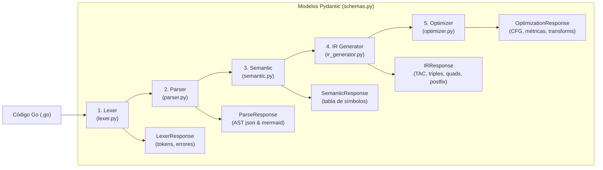

# Guía para Agentes y Desarrolladores (AGENTS.md)

Este documento es la referencia principal para agentes de inteligencia artificial y desarrolladores que interactúan, extienden o mantienen este repositorio. Contiene la guía operativa, comandos indispensables, convenciones internas de código y pautas de seguridad.

---

## 1. Visión General del Proyecto

- **Naturaleza**: Compilador interactivo con interfaz web para un subconjunto representativo del lenguaje de programación **Go (Golang)**.
- **Materia / Contexto**: Lenguajes y Autómatas II (LYA2).
- **Lenguaje base**: Python 3.14 (`requires-python = ">=3.14"`).
- **Herramientas centrales**:
  - [SLY (Sly Lex Yacc) 0.5](https://github.com/dabeaz/sly): Generación de analizadores léxico y sintáctico (LR parser).
  - [FastAPI 0.133+](https://fastapi.tiangolo.com/): Backend REST para exponer cada fase del compilador.
  - [Pydantic v2](https://docs.pydantic.dev/): Validación estricta de esquemas de entrada y salida.
  - [Mermaid.js](https://mermaid.js.org/): Renderizado visual en el navegador del AST y los Grafos de Flujo de Control (CFG).
  - Gestor de dependencias: `uv` (y compatibilidad con `pip` / `pyproject.toml`).

---

## 2. Cheat-Sheet de Comandos Operativos

Siempre que trabajes en este repositorio, utiliza el entorno virtual ubicado en `.venv`.

### 2.1. Entorno de Ejecución
```bash
# Activar entorno virtual
source .venv/bin/activate   # Linux / macOS
# o en Windows: .venv\Scripts\Activate.ps1

# Ejecutar con el binario directo del venv (recomendado para scripts/comandos desatendidos):
.venv/bin/python ...
```

### 2.2. Servidor Web / Aplicación
```bash
# Iniciar servidor FastAPI con recarga en caliente (puerto 8000 por defecto)
.venv/bin/python app/main.py

# Alternativa mediante uvicorn directo:
.venv/bin/python -m uvicorn app.main:app --host 127.0.0.1 --port 8000 --reload
```
Una vez iniciado, la aplicación está accesible en: `http://localhost:8000`.

### 2.3. Suite de Pruebas Unitarias
El proyecto utiliza el módulo nativo `unittest` de Python. **Toda modificación debe validar que las 56 pruebas pasen sin fallos.**

```bash
# Ejecutar todas las pruebas del proyecto (56 pruebas):
.venv/bin/python -m unittest discover tests

# Ejecutar módulos específicos de prueba:
.venv/bin/python -m unittest tests/test_lexer_parser.py   # Léxico y sintáctico (30 tests)
.venv/bin/python -m unittest tests/test_semantic.py       # Análisis semántico y scopes (12 tests)
.venv/bin/python -m unittest tests/test_ir.py             # Generación de TAC, triplos, cuádruplos (7 tests)
.venv/bin/python -m unittest tests/test_optimizer.py      # CFG y pases de optimización U3 (7 tests)
```

---

## 3. Arquitectura del Compilador y Flujo de Datos

El compilador se organiza en un pipeline lineal de 5 etapas acopladas mediante funciones de alto nivel:



### 3.1. Estructura de Directorios

```text
.
├── app/
│   ├── api/
│   │   ├── routes.py         # Endpoints FastAPI (/tokenize, /parse, /semantic, /ir, /optimize, exports)
│   │   └── schemas.py        # Modelos Pydantic v2 de entrada y salida
│   ├── core/
│   │   ├── lexer.py          # Clase MyLexer (SLY) y función analyze_code()
│   │   ├── parser.py         # Clase MyParser (SLY) y función analyze_syntax()
│   │   ├── semantic.py       # SemanticAnalyzer, Scope, SymbolRecord y analyze_semantics()
│   │   ├── ir_generator.py   # IRGenerator, Quadruple y generate_ir()
│   │   └── optimizer.py      # IROptimizer, BasicBlock, ControlFlowGraph, Quad y optimize_code()
│   ├── templates/
│   │   └── index.html        # SPA interactiva con CSS Vanilla, JS y Mermaid.js
│   └── main.py               # Punto de entrada de la aplicación FastAPI
├── tests/                    # Suite de 56 pruebas con unittest
│   ├── test_lexer_parser.py
│   ├── test_semantic.py
│   ├── test_ir.py
│   └── test_optimizer.py
├── ejemplos/                 # Archivos .go e .ir de demostración y pruebas integradoras
│   ├── aritmetica.ir
│   ├── if_else.ir
│   ├── for_loop.ir
│   └── u3/
│       ├── ejemplo_integrador.go
│       ├── before.ir
│       └── after.ir
├── AGENTS.md                 # Este documento (instrucciones para agentes)
├── current-state.md          # Radiografía exhaustiva del estado técnico del proyecto
├── README.md                 # Documentación general para humanos
├── pyproject.toml            # Especificación de proyecto Python y dependencias
└── uv.lock                   # Lockfile determinista para uv
```

---

## 4. Convenciones Internas y Estructuras de Datos

### 4.1. AST (Árbol de Sintaxis Abstracta)
- Los nodos del AST generados por `parser.py` son representados como **tuplas etiquetadas**:
  - Nodo raíz: `('program', [top_level_items...])`
  - Declaración de variable: `('var_decl', name, data_type, init_expr, line)`
  - Declaración corta: `('short_var_decl', name, expr, line)`
  - Declaración de función: `('func_decl', name, [(param, type)...], return_type, [body_stmts...])`
  - Condicional: `('if', condition_expr, then_block, else_block, line)`
  - Bucle: `('for_three', init, cond, post, body, line)` o `('for_cond', cond, body, line)` o `('for_inf', body, line)`
  - Operación binaria: `('binary_op', op, left_node, right_node, line)`
  - Literal: `('literal', lit_type, value, line)`

### 4.2. Jerarquía de Ámbitos (Scopes en `semantic.py`)
- Los scopes siguen una cadena de resolución con referencia a `parent`:
  - Raíz: `"global"`
  - Funciones: `"local:<nombre_funcion>"` (ej. `"local:ejecutar"`)
  - Bloques anidados: `"local:<nombre_funcion>:if"`, `"local:<nombre_funcion>:for"`
- Métodos clave de `Scope`:
  - `define(name, data_type, line)`: Registra el símbolo en el ámbito actual; falla si ya existe en dicho ámbito.
  - `lookup(name)`: Busca el símbolo recursivamente hacia los ámbitos padres.
  - `lookup_current(name)`: Solo busca en el ámbito actual.

### 4.3. Cuádruplos y Código Intermedio
Existen dos representaciones de cuádruplos optimizadas para su respectivo módulo:
1. `ir_generator.py` -> `Quadruple(index, op, arg1, arg2, result)`
   - Formato textual Triplo: `#{index}  ({op}, {arg1}, {arg2}, {result})`
2. `optimizer.py` -> `Quad(op, arg1, arg2, result, block_id)`
   - Vinculado al bloque básico del CFG (`block_id`, e.g. `"B1"`, `"B2"`).
   - Métodos: `to_tac()` para convertir a Three-Address Code y `clone()` para transformaciones inmutables.

### 4.4. Operadores TAC estándar
- Aritméticos y relacionales: `+`, `-`, `*`, `/`, `%`, `==`, `!=`, `<`, `<=`, `>`, `>=`
- Saltos y etiquetas: `label`, `goto`, `ifFalse`, `ifTrue`
- Funciones: `param`, `call`, `return`, `func_begin`, `func_end`

---

## 5. Protocolos para Extender el Compilador

### 5.1. Cómo añadir una nueva construcción sintáctica
Cuando necesites añadir una nueva característica del subconjunto de Go:
1. **Léxico (`app/core/lexer.py`)**:
   - Si requiere nuevas palabras reservadas o símbolos, añádelos a `tokens` o `literals`.
   - Si es palabra reservada, mapea el string en `ID['keyword'] = TOKEN`.
2. **Sintáctico (`app/core/parser.py`)**:
   - Define la regla gramatical con `@_('...')`.
   - Retorna una tupla representativa para el AST que preserve el número de línea: `line = getattr(p, 'lineno', 1)`.
   - Actualiza el generador Mermaid del AST si el nodo requiere visualización específica.
3. **Semántico (`app/core/semantic.py`)**:
   - Agrega el handler correspondiente en el visitor de `SemanticAnalyzer` (`_visit_stmt` o `_infer_type`).
   - Verifica compatibilidad de tipos y registra o consulta los símbolos en el `current_scope`.
4. **Código Intermedio (`app/core/ir_generator.py`)**:
   - Agrega la emisión de cuádruplos/TAC en `_generate_stmt` o `_generate_expr`.
5. **Optimizador (`app/core/optimizer.py`)**:
   - Si la nueva instrucción involucra flujo de control (saltos), asegúrate de que sea reconocida como líder de bloque o salto en `from_quads`.
6. **Pruebas (`tests/`)**:
   - Escribe casos de prueba en el archivo de test correspondiente y corre `.venv/bin/python -m unittest discover tests`.

### 5.2. Cómo añadir una nueva técnica de optimización
En `app/core/optimizer.py`:
1. Crea un método privado en `IROptimizer`, e.g., `_apply_mi_optimizacion(self, quads: list[Quad]) -> tuple[list[Quad], bool]`.
2. Devuelve `(nuevos_quads, modificado: bool)`.
3. Registra cada optimización efectuada llamando a:
   ```python
   self.add_transformation(
       block_id=quad.block_id,
       technique="Nombre de la Técnica",
       orig=quad.to_tac(),
       opt=nuevo_quad.to_tac(), # o "" si fue eliminada
       just="Justificación técnica de la regla aplicada"
   )
   ```
4. Agrega la llamada a tu método dentro del bucle iterativo de `optimize(self, quads)` en el orden correspondiente.
5. Agrega pruebas unitarias en `tests/test_optimizer.py`.

---

## 6. Reglas de Oro para Agentes de IA

> [!CAUTION]
> 1. **No romper la suite de pruebas**: Antes de finalizar cualquier tarea, corre `.venv/bin/python -m unittest discover tests`. Debe reportar `Ran 56 tests in ... OK`.
> 2. **Advertencias de SLY**: Al inicializar el parser se imprimirán advertencias de `shift/reduce` y `reduce/reduce` (actualmente 44 y 4). Esto es normal debido a la ausencia de análisis con inserción obligatoria de `;` al estilo de la especificación completa de Go. No intentes reescribir la gramática arbitrariamente para eliminar estos warnings sin consultar.
> 3. **Preservar la inmutabilidad de Quads en transformaciones**: Cuando optimices código en `optimizer.py`, utiliza `q.clone()` o listas nuevas para evitar efectos secundarios en pasos anteriores del log de transformaciones.
> 4. **Tipos Pydantic sincronizados**: Cualquier cambio en la estructura de retorno de los módulos de `core/` debe verse reflejado en `app/api/schemas.py` y verificado en `app/api/routes.py`.
> 5. **Rama activa**: El trabajo reciente y la entrega de Unidad 3 se encuentra en la rama `u3-optimizacion`. Siempre verifica la rama en la que estás trabajando con `git status` o `git branch`.
