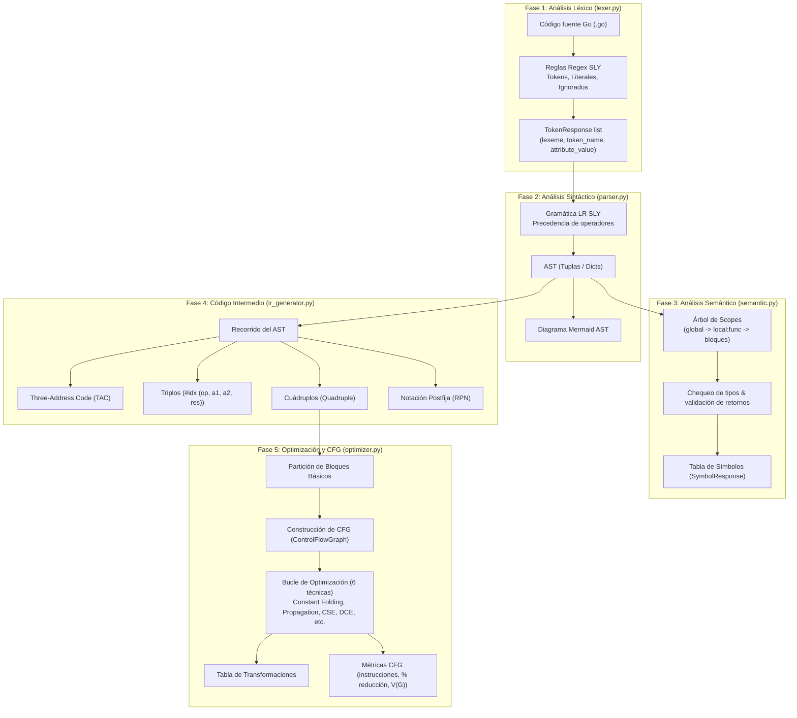

# Estado Actual del Proyecto (current-state.md)

Este documento ofrece una radiografía técnica y exhaustiva del compilador para el subconjunto de Go al estado actual del repositorio. Sirve como fuente de verdad para el diseño del sistema, capacidades implementadas, limitaciones conocidas y métricas de calidad.

---

## 1. Resumen Ejecutivo

- **Nombre del Proyecto**: Analizador y Compilador para Subconjunto de Go (Golang).
- **Asignatura**: Lenguajes y Autómatas II (LYA2).
- **Entorno de Ejecución**: Python 3.14 con entorno virtual `.venv` y gestor `uv`.
- **Ramas de Git**:
  - `main`: Contiene el desarrollo completado hasta la Unidad 2 (Generación de Código Intermedio / IR).
  - `u3-optimizacion` (Rama activa): Incorpora la Unidad 3 completa: particionamiento en bloques básicos, construcción y renderizado de Grafos de Flujo de Control (CFG), 6 técnicas de optimización iterativa, tabla de transformaciones y métricas cuantitativas.
- **Estado de Pruebas**: **56 pruebas unitarias implementadas, 56 pasando (100% éxito)** en 0.034 segundos.
- **Líneas de Código (Core)**: ~2,970 líneas distribuidas en 5 módulos en `app/core/`.

---

## 2. Radiografía Detallada por Fases del Compilador



---

### Fase 1: Análisis Léxico ([`app/core/lexer.py`](file:///home/jorge/Documents/LYA2/lexical_analyzer/app/core/lexer.py))
- **Mecanismo**: `sly.Lexer`.
- **Tokens Soportados**:
  - Palabras reservadas: `package`, `import`, `func`, `var`, `const`, `type`, `struct`, `if`, `else`, `for`, `return`, `true`, `false`, `nil`.
  - Tipos primitivos reconocidos como tipo `TYPE`: `int`, `string`, `bool`, `float64`, `float32`, `byte`, `rune`, `uint`, `int64`, `int32`, `uint64`, `uint32`, `any`, `error`.
  - Literales: Enteros (`INT_LIT`), flotantes (`FLOAT_LIT`), strings delimitados por comillas dobles `"..."` o comillas invertidas `` `...` `` (`STRING_LIT`).
  - Operadores de asignación: `=`, `:=`, `+=`, `-=`, `*=`, `/=`.
  - Operadores relacionales: `==`, `!=`, `<`, `<=`, `>`, `>=` (etiquetados bajo `OPREL` con atributo específico).
  - Operadores lógicos y aritméticos: `&&`, `||`, `!`, `+`, `-`, `*`, `/`, `%`, `++`, `--`.
  - Delimitadores y puntuadores: `(`, `)`, `{`, `}`, `[`, `]`, `,`, `;`, `:`, `.`.
- **Manejo de Comentarios y Espacios**:
  - Comentarios de una sola línea: `//.*` ignorados automáticamente.
  - Comentarios multilínea: `/* ... */` ignorados mediante decorador regex que preserva el incremento exacto del contador de línea `self.lineno`.
  - Saltos de línea `\n+`: incrementan el contador de línea para reportes de error precisos.
- **Salida**: `LexerResponse` conteniendo lista de tokens estructurados (`lexeme`, `token_name`, `attribute_value`) y lista de errores léxicos.

---

### Fase 2: Análisis Sintáctico ([`app/core/parser.py`](file:///home/jorge/Documents/LYA2/lexical_analyzer/app/core/parser.py))
- **Mecanismo**: `sly.Parser` (algoritmo LALR(1)).
- **Gramática Soportada**:
  - Declaraciones superiores: `package`, `import` simple (`import "fmt"`) y múltiple (`import ( "fmt" "math" )`).
  - Declaración y definición de funciones: `func nombre(params) tipo_retorno { cuerpo }`.
  - Declaración de structs y tipos personalizados: `type Persona struct { nombre string; edad int }`.
  - Declaraciones de variables: explícitas (`var x int = 10`), sin valor inicial (`var x int`), cortas (`x := 20`), constantes (`const pi float64 = 3.14159`).
  - Estructuras de control:
    - Condicionales: `if condición { ... } else if { ... } else { ... }`.
    - Bucles `for`: bucle clásico de 3 cláusulas (`for i := 0; i < n; i++`), bucle condicional tipo while (`for x < 100`), bucle infinito (`for { ... }`).
  - Asignaciones e incremento: `=`, `+=`, `-=`, `*=`, `/=`, `++`, `--`.
  - Expresiones con precedencia matemática estricta:
    1. Unario (`!`, `-`)
    2. Multiplicativos (`*`, `/`, `%`)
    3. Aditivos (`+`, `-`)
    4. Relacionales (`==`, `!=`, `<`, `<=`, `>`, `>=`)
    5. Conjunción (`&&`)
    6. Disyunción (`||`)
- **Conflictos Gramaticales de SLY**:
  - El parser reporta **44 conflictos shift/reduce** y **4 conflictos reduce/reduce**.
  - *Causa*: En Go oficial, el lexer inserta puntos y comas de manera automática en ciertos tokens de fin de línea. Al procesar un subconjunto sin lexer con inserción estricta de `;`, el analizador SLY resuelve ambiguamente la cláusula colgante `else` (dangling-else) y ciertas secuencias de declaraciones / sentencias mediante la regla por defecto de SLY (priorizar el *shift*).
  - *Impacto*: No afecta la validez sintáctica de los programas correctos; las 56 pruebas pasan con éxito.
- **Salida**: `ParseResponse` con bandera `success`, árbol AST en formato JSON anidado, y código Mermaid (`graph TD`) para su renderizado gráfico interactivo.

---

### Fase 3: Análisis Semántico ([`app/core/semantic.py`](file:///home/jorge/Documents/LYA2/lexical_analyzer/app/core/semantic.py))
- **Estructura de Ámbitos (Scopes)**:
  - Clase `Scope`: Implementa una cadena de entornos léxicos (`parent`).
  - Ámbitos estándar: `"global"`, `"local:<nombre_func>"`, y sub-ámbitos `"local:<func>:if"` y `"local:<func>:for"`.
  - Clase `SymbolRecord`: Almacena `name`, `data_type`, `scope`, y `line`.
- **Reglas y Chequeos Semánticos Validados**:
  - Detección de identificadores no declarados antes de su uso.
  - Prevención de redeclaración de variables dentro del mismo ámbito léxico.
  - Coherencia de tipos en operaciones binarias (ej. no sumar `string` con `int`).
  - Validación de expresiones booleanas en condiciones de `if` y `for`.
  - Validación de coincidencia de tipo en asignaciones simples y cortas.
  - Verificación del tipo y presencia de sentencia `return` en funciones tipadas.
  - Validación de coincidencia de número y tipos de argumentos en llamadas a funciones (`call_stmt` y `call_expr`).
- **Salida**: `SemanticResponse` con lista de errores semánticos y lista de símbolos encontrados (`SymbolResponse`).

---

### Fase 4: Generación de Código Intermedio ([`app/core/ir_generator.py`](file:///home/jorge/Documents/LYA2/lexical_analyzer/app/core/ir_generator.py))
- **Mecanismo**: Recorrido de los nodos del AST con emisión de cuádruplos y generación de temporales (`t1`, `t2`, ...) y etiquetas (`L1`, `L2`, ...).
- **Formatos Producidos**:
  1. **Three-Address Code (TAC)**: Código legible en formato textual de 3 direcciones:
     ```text
     t1 = 4 * 2
     t2 = 3 + t1
     x = t2
     ```
  2. **Triplos**: Lista indexada de operaciones con sintaxis `#idx (op, arg1, arg2, result)` apta para su exportación a archivos `.ir`.
  3. **Cuádruplos**: Objetos `Quadruple(index, op, arg1, arg2, result)` expuestos en la API.
  4. **Notación Postfija**: Conversión de expresiones infijas a postfijas (RPN), útil para validación de precedencia.
- **Control de Flujo en IR**:
  - Sentencias condicionales traducidas con `ifFalse <cond> goto <label>`.
  - Bucles traducidos con etiquetas de inicio, salto condicional de salida y `goto` incondicional al inicio.
- **Exportación**: Endpoint `/export-ir` permite descargar el código intermedio completo como archivo plano `.ir`.

---

### Fase 5: Optimización de Código Intermedio y CFG ([`app/core/optimizer.py`](file:///home/jorge/Documents/LYA2/lexical_analyzer/app/core/optimizer.py))
Corresponde a la implementación de la **Unidad 3** del curso (Optimización mediante Bloques Básicos y Grafo de Flujo de Control).

#### 1. Partición en Bloques Básicos
- Algoritmo canónico de identificación de **Líderes**:
  - La primera instrucción del código intermedio.
  - Cualquier instrucción que sea destino de un salto condicional o incondicional (etiquetas `label`).
  - Cualquier instrucción que siga inmediatamente a una instrucción de salto (`goto`, `ifFalse`, `ifTrue`, `return`).
- Cada bloque básico (`BasicBlock`) agrupa las instrucciones desde un líder hasta justo antes del siguiente líder.

#### 2. Grafo de Flujo de Control (CFG)
- Clase `ControlFlowGraph`:
  - Enlaza bloques calculando explícitamente `predecessors` y `successors`.
  - Agrega nodo especial de `[Inicio]` y transiciones a `[Fin]`.
  - Genera automáticamente representación en **Mermaid** (`graph TD`) con estilos visuales diferenciados para bloques normales, de entrada, salida e inalcanzables.

#### 3. Técnicas de Optimización Implementadas (6 Técnicas)
1. **Plegado de Constantes (*Constant Folding*)**: Evalúa en tiempo de compilación expresiones aritméticas y relacionales con operandos constantes (e.g., `20 + 30` -> `50`, `5 > 10` -> `0`).
2. **Propagación de Constantes (*Constant Propagation*)**: Sustituye usos posteriores de variables a las que se les asignó una constante conocida dentro del bloque básico.
3. **Eliminación de Subexpresiones Comunes (*CSE - Common Subexpression Elimination*)**: Detecta cálculos idénticos cuyos operandos no han variado y reutiliza el temporal previo.
4. **Eliminación de Código Muerto (*DCE - Dead Code Elimination*)**: Suprime asignaciones a variables o temporales cuyo valor no es utilizado antes de un `return` o final de bloque.
5. **Eliminación de Bloques Inalcanzables (*Unreachable Code Elimination*)**: Identifica y elimina bloques básicos que no tienen ningún predecesor alcanzable desde el nodo de entrada (e.g., sentencias después de un `return`).
6. **Simplificación de Saltos (*Jump Simplification*)**: Elimina saltos innecesarios (como un salto incondicional a la instrucción inmediatamente siguiente).
7. **Eliminación de Asignaciones Identidad**: Suprime cuádruplos de la forma `x = x` o `t1 = t1`.

#### 4. Bucle de Optimización Iterativo
- `IROptimizer.optimize()` itera aplicando las técnicas hasta alcanzar un **punto fijo** (ninguna técnica produce cambios adicionales) o un máximo de 10 pasadas.
- Cada transformación se registra en una lista de objetos `Transformation` (`step`, `block_id`, `technique`, `original_code`, `optimized_code`, `justification`).

#### 5. Métricas Cuantitativas Calculadas (`CFGMetricsResponse`)
- Instrucciones totales antes y después.
- Porcentaje global de reducción de instrucciones.
- Temporales ahorrados.
- Complejidad Ciclomática de McCabe antes y después:
  $$V(G) = E - N + 2P$$
  (Donde $E$ es aristas, $N$ nodos y $P$ componentes conexas).
- Conteo de bloques básicos antes y después.

---

### Fase 6: Capa Web y Endpoints REST

La aplicación web está montada en FastAPI ([`app/main.py`](file:///home/jorge/Documents/LYA2/lexical_analyzer/app/main.py) y [`app/api/routes.py`](file:///home/jorge/Documents/LYA2/lexical_analyzer/app/api/routes.py)):

| Método | Endpoint | Entrada | Salida | Descripción |
| :--- | :--- | :--- | :--- | :--- |
| `GET` | `/` | Ninguna | `text/html` | Servidor de la interfaz gráfica SPA ([`index.html`](file:///home/jorge/Documents/LYA2/lexical_analyzer/app/templates/index.html)) |
| `POST` | `/tokenize` | `CodeRequest` | `LexerResponse` | Retorna tokens identificados y errores léxicos |
| `POST` | `/parse` | `CodeRequest` | `ParseResponse` | Retorna AST en JSON y diagrama Mermaid |
| `POST` | `/semantic` | `CodeRequest` | `SemanticResponse` | Retorna tabla de símbolos y errores semánticos |
| `POST` | `/ir` | `CodeRequest` | `IRResponse` | Retorna TAC, triplos, cuádruplos y notación postfija |
| `POST` | `/export-ir` | `CodeRequest` | Archivo plano (`programa.ir`) | Descarga el archivo de triplos intermedios |
| `POST` | `/optimize` | `CodeRequest` | `OptimizationResponse` | Ejecuta optimizaciones, CFG antes/después y métricas |
| `POST` | `/optimize/export-before` | `CodeRequest` | Archivo plano (`antes.ir`) | Descarga el IR original previo a optimización |
| `POST` | `/optimize/export-after` | `CodeRequest` | Archivo plano (`despues.ir`) | Descarga el IR final optimizado |

---

## 3. Matriz de Cobertura del Subconjunto de Go

Esta matriz define con exactitud qué sintaxis de Go está soportada por el compilador y qué características están intencionalmente fuera de alcance:

| Característica de Go | Soportado | Observaciones / Ejemplo |
| :--- | :---: | :--- |
| Declaración de paquete | ✅ | `package main` |
| Importaciones simples y múltiples | ✅ | `import "fmt"` / `import ( "fmt" "os" )` |
| Declaración de variables explícitas | ✅ | `var x int = 10`, `var total float64` |
| Declaraciones cortas | ✅ | `x := 20` |
| Constantes | ✅ | `const Pi float64 = 3.14159` |
| Tipos y Structs básicos | ✅ | `type Persona struct { nombre string; edad int }` |
| Funciones con parámetros y retorno | ✅ | `func suma(a int, b int) int { return a + b }` |
| Condicionales `if` / `else if` / `else` | ✅ | Soporta condiciones anidadas |
| Bucles `for` (3 cláusulas) | ✅ | `for i := 0; i < 10; i++ { ... }` |
| Bucles `for` (condición while) | ✅ | `for x < 100 { ... }` |
| Bucles `for` infinitos | ✅ | `for { ... }` |
| Operadores aritméticos y lógicos | ✅ | `+`, `-`, `*`, `/`, `%`, `&&`, `||`, `!`, `++`, `--` |
| Operadores relacionales | ✅ | `==`, `!=`, `<`, `<=`, `>`, `>=` |
| Comentarios de una y varias líneas | ✅ | `// comentario` y `/* bloque */` |
| Punteros y operadores de memoria | ❌ | No soporta `*T`, `&variable` |
| Goroutines y concurrencia | ❌ | No soporta la palabra clave `go` |
| Canales de comunicación | ❌ | No soporta `chan`, `<-` |
| Slices dinámicos y Maps | ❌ | No soporta `make()`, `append()`, mapas con llaves |
| Métodos de structs (Receivers) | ❌ | No soporta `func (p Persona) Saludar() { ... }` |
| Interfaces dinámicas | ❌ | No soporta `type MiInterfaz interface { ... }` |
| Sentencias de control adicionales | ❌ | No soporta `switch`/`case`, `defer`, `panic`/`recover` |

---

## 4. Inventario de Pruebas Unitarias

La suite consta de 56 pruebas automáticas distribuidas en 4 módulos:

| Archivo de Prueba | Casos de Prueba | Componentes Validados |
| :--- | :---: | :--- |
| [`tests/test_lexer_parser.py`](file:///home/jorge/Documents/LYA2/lexical_analyzer/tests/test_lexer_parser.py) | **30 tests** | Reconocimiento de palabras reservadas, operadores compuestos (`:=`, `+=`, `==`), literales enteros, flotantes, strings simples y raw strings, comentarios multilínea, delimitadores, parsing de declaraciones `var`, `func`, `struct`, bucles `for`, `if/else`, precedencia de operadores, y captura de errores sintácticos con línea/columna. |
| [`tests/test_semantic.py`](file:///home/jorge/Documents/LYA2/lexical_analyzer/tests/test_semantic.py) | **12 tests** | Construcción de tabla de símbolos, verificación de scopes jerárquicos (global, local, bloques for/if), prevención de variables duplicadas en el mismo ámbito, detección de variables no declaradas, verificación de tipos en operaciones aritméticas y booleanas, comprobación de retornos de función. |
| [`tests/test_ir.py`](file:///home/jorge/Documents/LYA2/lexical_analyzer/tests/test_ir.py) | **7 tests** | Generación de TAC, triplos y cuádruplos para aritmética con precedencia, traducción de estructuras `if-else` con etiquetas y saltos condicionales, bucles `for`, llamadas y definiciones de funciones, generación de expresiones postfijas. |
| [`tests/test_optimizer.py`](file:///home/jorge/Documents/LYA2/lexical_analyzer/tests/test_optimizer.py) | **7 tests** | Particionamiento correcto en bloques básicos según líderes, cálculo de predecesores/sucesores y complejidad ciclomática del CFG, Constant Folding, Constant Propagation, Common Subexpression Elimination, Dead Code Elimination, y prueba integradora de Unidad 3 con reporte de métricas. |
| **Total** | **56 tests** | **100% pasando (0 fallos, 0 errores)** |

---

## 5. Catálogo de Archivos de Muestra y Recursos

El repositorio incluye casos de prueba y ejemplos listos para utilizar:
- [`ejemplos/u3/ejemplo_integrador.go`](file:///home/jorge/Documents/LYA2/lexical_analyzer/ejemplos/u3/ejemplo_integrador.go): Ejemplo canónico de la Unidad 3 que contiene oportunidades para las 6 técnicas de optimización (subexpresión común `a+b`, propagación de `a=5` y `b=10`, plegado `20+30`, código muerto `w=100` y código inalcanzable `w=200` tras el `return`).
- [`ejemplos/u3/before.ir`](file:///home/jorge/Documents/LYA2/lexical_analyzer/ejemplos/u3/before.ir): Código intermedio en triplos previo a la optimización del ejemplo integrador (23 instrucciones).
- [`ejemplos/u3/after.ir`](file:///home/jorge/Documents/LYA2/lexical_analyzer/ejemplos/u3/after.ir): Código intermedio resultante tras aplicar la optimización (reducido a 5 instrucciones).
- [`ejemplos/aritmetica.ir`](file:///home/jorge/Documents/LYA2/lexical_analyzer/ejemplos/aritmetica.ir), [`ejemplos/if_else.ir`](file:///home/jorge/Documents/LYA2/lexical_analyzer/ejemplos/if_else.ir), [`ejemplos/for_loop.ir`](file:///home/jorge/Documents/LYA2/lexical_analyzer/ejemplos/for_loop.ir): Archivos IR de referencia para Unidad 2.
- [`rubrica_u3.txt`](file:///home/jorge/Documents/LYA2/lexical_analyzer/rubrica_u3.txt): Rúbrica oficial de evaluación de la Unidad 3 (código original, bloques básicos, GFG, técnicas de optimización, tabla de transformaciones, código optimizado y análisis de resultados).
- [`codigo_intermedio.go`](file:///home/jorge/Documents/LYA2/lexical_analyzer/codigo_intermedio.go) y [`ejemplo.txt`](file:///home/jorge/Documents/LYA2/lexical_analyzer/ejemplo.txt): Código de prueba base y notas pedagógicas de optimización.

---

## 6. Deuda Técnica y Consideraciones de Diseño

1. **Diferencias entre ramas (`main` vs `u3-optimizacion`)**:
   - La rama `u3-optimizacion` cuenta con 2,078 líneas adicionales que aún no han sido fusionadas a `main`. Se recomienda mantener el trabajo de la Unidad 3 sobre esta rama o realizar el pull request correspondiente.
2. **Dualidad de Clases de Cuádruplos**:
   - `app/core/ir_generator.py` define `Quadruple` (orientado a la emisión inicial de TAC, triplos y orden secuencial).
   - `app/core/optimizer.py` define `Quad` (orientado a bloques básicos y mutaciones).
   - Aunque ambas cumplen su rol sin conflictos, en una futura refactorización podrían unificarse en un modelo común en `schemas.py` o un módulo `ir_types.py`.
3. **Conflictos SLY (44 shift/reduce, 4 reduce/reduce)**:
   - Son advertencias esperadas de SLY en analizadores sin inserción de `;`. No impiden la compilación ni el paso de tests, pero cualquier cambio a la gramática debe ser verificado cuidadosamente contra la suite de tests.
4. **Optimización Intra-Procedural**:
   - Las optimizaciones actuales se aplican dentro de las funciones analizadas. No se realiza propagación inter-procedural (entre distintas funciones llamadas) ni inlining de funciones.
